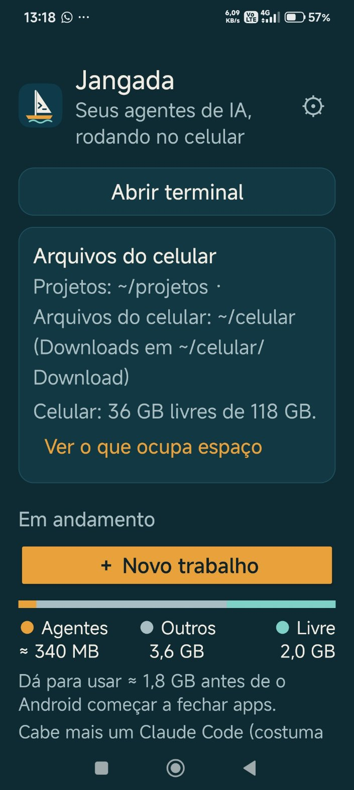
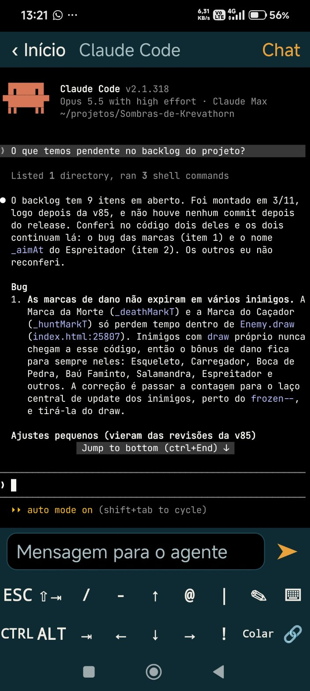

  

<h1 align="center">Jangada</h1>

  <b>Claude Code, Codex, OpenCode, Qwen Code e outros agentes de IA de programação, direto no seu Android.</b> 
  Sem root, sem computador e sem servidor.

  
  
  
  

  <a href="https://github.com/JonJonesBR/jangada/releases/latest/download/Jangada.apk"><b>⬇️ Baixar o APK</b></a>
  &nbsp;·&nbsp;
  <a href="#instalar">Como instalar</a>
  &nbsp;·&nbsp;
  <a href="#english">English</a>

  
  
  
  

O Jangada coloca um Linux Debian completo dentro do app e transforma o celular num lugar para programar com IA. Você instala um agente com um toque, cria ou clona um projeto e conversa com ele como num app de mensagens. O agente lê, escreve e testa o código numa pasta de verdade. No fim, você confere as mudanças, faz o commit e envia para o GitHub, tudo pelo celular.

## O que dá para fazer

### 💬 Conversar com o agente
- Respostas em tempo real, com Markdown, tabelas, blocos de código com Copiar e o plano de tarefas do agente.
- **Permissões com botões:** Permitir, Recusar ou Permitir sempre nesta conversa. Permitir e Recusar também aparecem na notificação.
- Fotos, prints e arquivos como anexos, ou compartilhados de qualquer app direto para o agente.
- Troca de modelo, esforço e modo no próprio chat; uso do contexto à vista, com atalho para compactar.
- Três visualizações (Detalhado, Normal e Resumo), fila de mensagens enquanto o agente trabalha e rascunho do que você ainda não enviou.
- No Claude Code, a mesma conversa no chat e no terminal.

### 📁 Trabalhar em projetos de verdade
- **Novo projeto:** cria a pasta com git e, se você quiser, o repositório no GitHub ou no GitLab (com o login do `gh` ou do `glab`).
- **Clonar** um repositório pelo endereço (https ou ssh), do GitHub, do GitLab ou de outro site. Repositórios privados pedem login.
- **Mudanças:** veja os arquivos alterados e o diff colorido, faça o commit (ou peça ao agente) e envie com `git push` para o repositório remoto.
- **Trabalho isolado:** uma cópia do repositório numa branch própria (git worktree), para o agente experimentar sem mexer no seu código. Depois, junte, descarte ou mantenha.
- Se você permitir, os agentes também leem e salvam nos arquivos do celular (`~/celular`: Downloads, Documentos…).

### ⚡ Vários agentes ao mesmo tempo
- Vários trabalhos rodando juntos (até 4, conforme a memória do aparelho), cada um com o seu agente e a sua pasta, sem um parar o outro.
- **Cuidado com a memória:** se ela apertar, o Linux encerra primeiro os comandos dos agentes (como navegadores de teste), não os agentes. Agentes parados "dormem" para liberar memória e continuam a conversa quando você escrever, e cada agente recebe orientações para não abrir vários navegadores ao mesmo tempo.
- A tela inicial mostra quem está trabalhando, quem espera você e quem terminou, com quem espera você em destaque.
- Os agentes continuam em segundo plano, com a tela apagada ou em outro app, e um aviso chega quando a resposta fica pronta (o gasto de bateria é maior; dá para desligar nas configurações).

### ⌨️ Terminal completo
- O terminal do Termux, com abas, teclas extras pensadas para agentes, caixa de texto com o corretor e o ditado do teclado, links clicáveis, fontes com os símbolos que os agentes usam e esquemas de cores.
- Um Debian de verdade: `apt install` o que precisar.

### 🔒 Seu, e só seu
- **Sem anúncios e sem rastreamento.** O próprio app só acessa a internet para instalar o Linux e os agentes e para ver se há versões novas. O resto do tráfego é dos agentes e do git que você usar.
- Suas conversas vão só para o serviço de IA que você escolher, com a sua conta ou chave.
- As chaves de API ficam guardadas com criptografia (Android Keystore). Há backup dos projetos e das configurações dos agentes.
- Código aberto (GPL-3.0).

## Agentes

Instalar, atualizar e desinstalar com um toque, vendo o espaço que cada um ocupa. Na primeira vez, o app guia o login de cada agente.

| Agente | De | Chat | Terminal |
|---|---|:---:|:---:|
| [Claude Code](https://github.com/anthropics/claude-code) | Anthropic | ✅ | ✅ |
| [Codex](https://github.com/openai/codex) | OpenAI | ✅ | ✅ |
| OpenCode | OpenCode | ✅ | ✅ |
| Qwen Code | Qwen (Alibaba) | ✅ | ✅ |
| Pi | Earendil | ✅ | ✅ |
| oh-my-pi (omp) | oh-my-pi | ✅ | ✅ |
| Hermes Agent | Nous Research | ✅ | ✅ |
| Command Code | Command Code | ✅ | ✅ |
| Antigravity CLI (agy) | Google | ✅ | ✅ |
| OpenClaw | OpenClaw | — | ✅ |

O chat funciona com o Claude Code e com os agentes que falam o [Agent Client Protocol](https://agentclientprotocol.com). Quer outro agente? Veja como adicionar em [docs/CONTRIBUTING.md](docs/CONTRIBUTING.md).

## Instalar

1. Baixe o [`Jangada.apk`](https://github.com/JonJonesBR/jangada/releases/latest/download/Jangada.apk) e instale. O Android vai pedir permissão para instalar apps desta origem.
2. Abra o app e toque em **Instalar agora**. O Linux é preparado uma única vez, com cerca de 70 MB de download.
3. Escolha um agente, toque em **Instalar** e depois em **Conversar**.

**Atualizações automáticas:** adicione `https://github.com/JonJonesBR/jangada` no [Obtainium](https://github.com/ImranR98/Obtainium).

**Requisitos:** Android 8 ou mais novo, processador ARM de 64 bits (arm64) e cerca de 700 MB livres, mais o espaço dos agentes que você instalar.

## Perguntas frequentes

**Preciso de root ou de um computador?**
Não. Tudo roda dentro do app, no próprio celular.

**Quanto custa?**
O Jangada é gratuito. Cada agente usa a sua conta ou a sua chave de API no serviço de IA correspondente, com os planos e os limites de lá.

**Funciona sem internet?**
O app e o Linux funcionam, mas os agentes precisam de internet para falar com o serviço de IA.

**Por que não está na Play Store?**
Para rodar o Linux dentro do app, o Jangada usa `targetSdk 28`, a mesma escolha do Termux, e a Play Store não aceita isso. Por isso ele é distribuído pelo GitHub.

**O agente pode mexer no meu celular?**
Só dentro do Linux do app e, se você der a permissão, na pasta `~/celular`, que dá acesso aos seus arquivos. Os agentes perguntam antes de agir (rodar comandos, editar arquivos). Isso muda se você escolher Permitir sempre nesta conversa ou, no Claude Code, o modo Automático nas configurações.

## Como funciona

O Jangada usa o motor de terminal do [Termux](https://github.com/termux/termux-app) e roda um Debian oficial com [proot](https://github.com/termux/proot), sem root. Os agentes são instalados com os instaladores oficiais de cada projeto. O chat conversa com eles pelos protocolos que eles mesmos oferecem para a integração com editores.

Para contribuir, adicionar agentes ou compilar o APK, veja [docs/CONTRIBUTING.md](docs/CONTRIBUTING.md).

## Licença

[GPL-3.0](LICENSE). Créditos e licenças dos componentes de terceiros em [THIRD_PARTY_NOTICES.md](THIRD_PARTY_NOTICES.md).

---

## English

**Claude Code, Codex, OpenCode, Qwen Code and other AI coding agents, right on your Android. No root, no computer, no server.**

[**⬇️ Download the APK**](https://github.com/JonJonesBR/jangada/releases/latest/download/Jangada.apk)

Jangada puts a full Debian Linux inside the app and turns your phone into a place to code with AI. Install an agent with one tap, create or clone a project and chat with it like in a messaging app. The agent reads, writes and tests code in a real folder. Then you review the changes, commit them and push to GitHub, all from your phone.

### What you can do

- **💬 Chat with the agent:**
  - live answers with Markdown, tables, code blocks and the agent's plan;
  - permission buttons (Allow, Deny, Always allow in this conversation); Allow and Deny also appear in the notification;
  - attachments, and sharing from any app;
  - model, effort and mode switching, plus context usage;
  - Detailed, Normal and Summary views, a message queue and drafts;
  - for Claude Code, the same conversation in chat and terminal.
- **📁 Work on real projects:**
  - New project with git and, optionally, a GitHub or GitLab repository (using your `gh` or `glab` login);
  - clone a repository by its address (private ones need a login);
  - Changes screen with diff, commit and `git push`;
  - isolated jobs (git worktree) for the agent to experiment safely;
  - access to your phone files (`~/celular`), if you allow it.
- **⚡ Several agents at once:**
  - several jobs running side by side (up to 4, depending on the device's memory);
  - memory care: if memory runs low, Linux stops the agents' commands first (such as test browsers), not the agents; idle agents sleep to free memory and pick up the conversation when you write;
  - the home screen shows who is working, who is waiting for you and who is done;
  - agents keep going in the background and notify you when they are done (this uses more battery; you can turn it off in Settings).
- **⌨️ Full terminal:**
  - Termux's terminal with tabs, agent-friendly extra keys, a text box with your keyboard's autocorrect and voice typing, clickable links and color schemes;
  - a real Debian, so you can `apt install` anything.
- **🔒 Yours only:**
  - no ads, no tracking;
  - your conversations go only to the AI service you choose;
  - encrypted API keys (Android Keystore), backup, and open source code.

### Agents

Claude Code, Codex, OpenCode, Qwen Code, Pi, oh-my-pi, Hermes Agent, Command Code and Antigravity CLI work in both chat and terminal. OpenClaw works in the terminal only. One-tap install, update and uninstall, with a guided first login.

### Install

1. Download [`Jangada.apk`](https://github.com/JonJonesBR/jangada/releases/latest/download/Jangada.apk) and install it.
2. Open the app and tap **Install now**. Linux is set up once, with about 70 MB to download.
3. Pick an agent, tap **Install**, then **Talk**.

For automatic updates, add `https://github.com/JonJonesBR/jangada` to [Obtainium](https://github.com/ImranR98/Obtainium).

**Requirements:** Android 8 or newer, a 64-bit ARM (arm64) device and about 700 MB free. Jangada is free; each agent uses your own account or API key with its AI provider.

### FAQ

- **Do I need root or a computer?** No. Everything runs inside the app, on the phone.
- **How much does it cost?** Jangada is free. Each agent uses your own account or API key with its AI provider, under that provider's plans and limits.
- **Does it work offline?** The app and Linux do, but the agents need internet to reach their AI service.
- **Can the agent touch my phone?** Only inside the app's Linux and, if you grant it, the `~/celular` folder. Agents ask before acting, unless you choose Always allow in this conversation or, in Claude Code, Automatic mode in Settings.

### How it works

Jangada uses Termux's terminal engine and runs an official Debian through proot, without root. It is distributed through GitHub rather than the Play Store because it targets SDK 28, like Termux, to run Linux inside the app.

To contribute, add agents or build the APK, see [docs/CONTRIBUTING.md](docs/CONTRIBUTING.md).

**License:** [GPL-3.0](LICENSE). Third-party notices are in [THIRD_PARTY_NOTICES.md](THIRD_PARTY_NOTICES.md).
